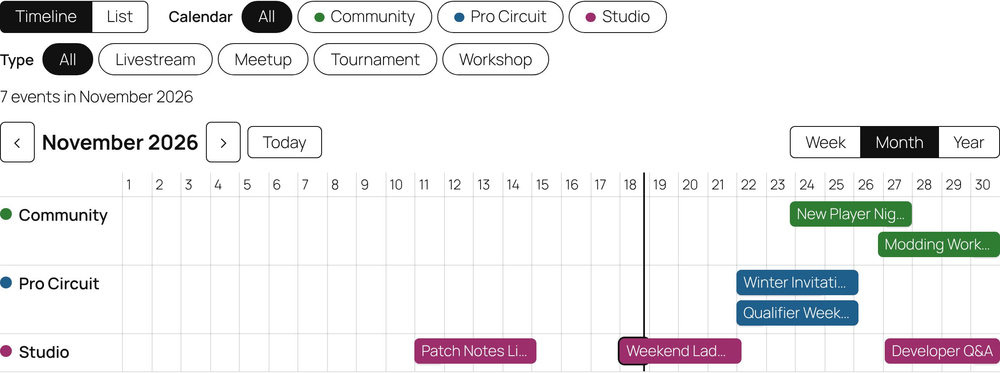
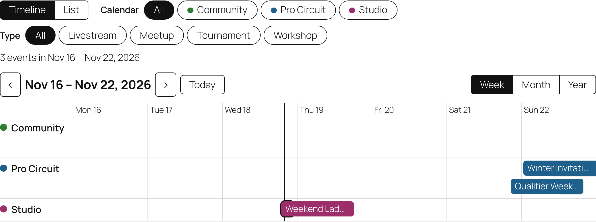
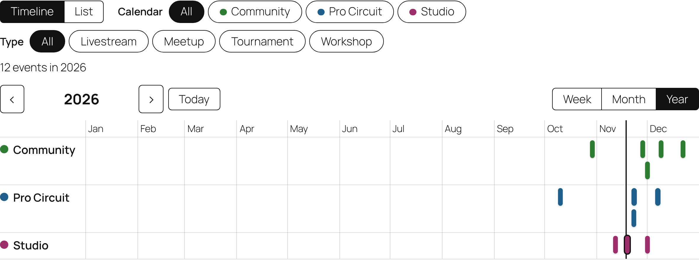
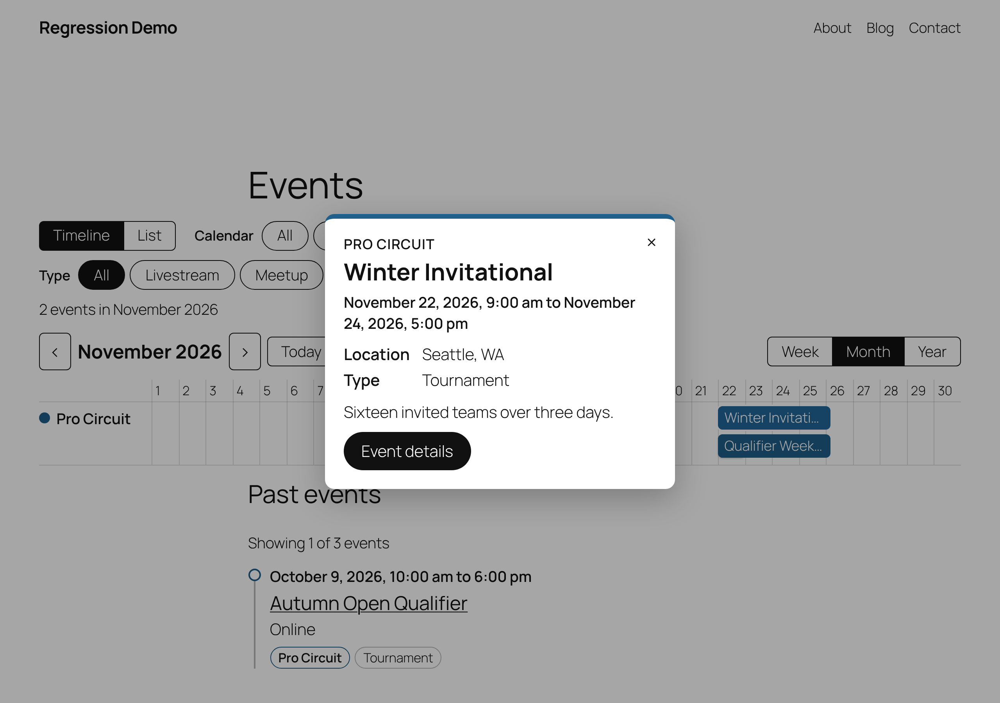
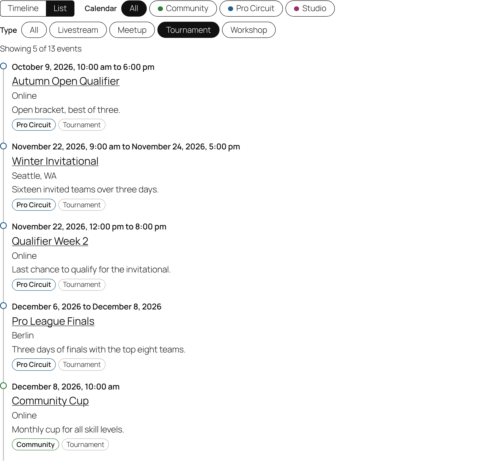
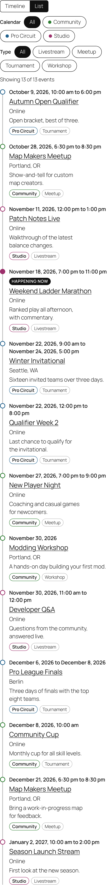
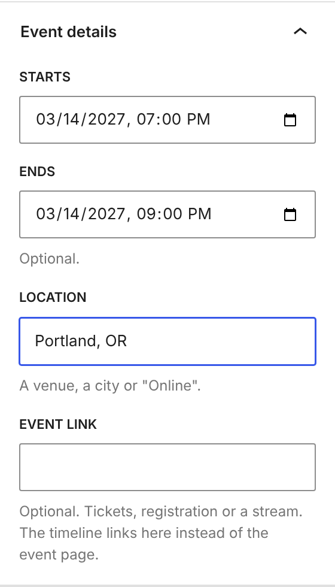
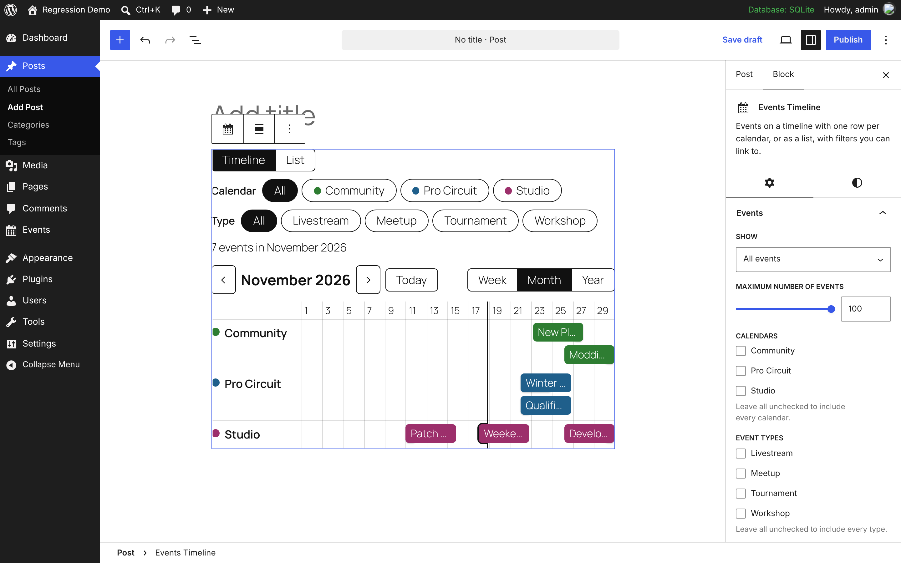
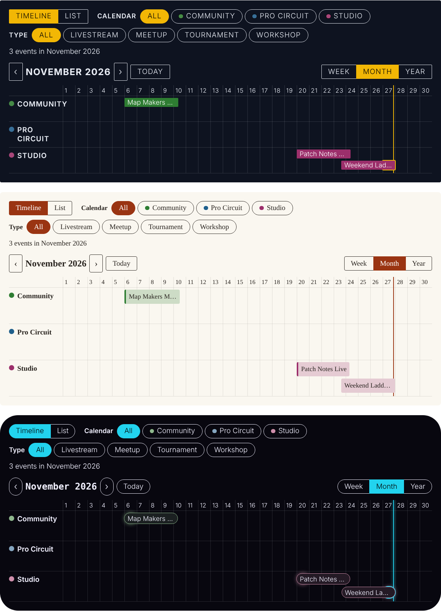
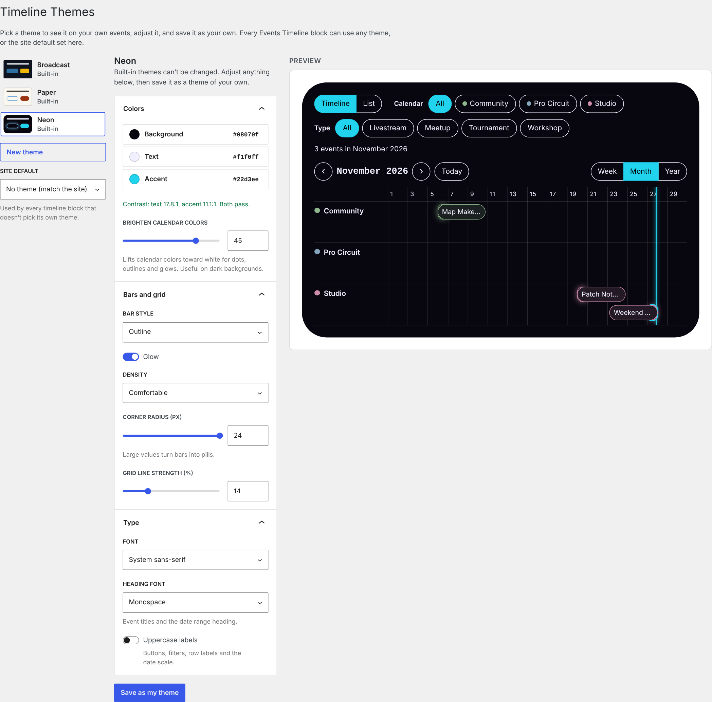

# Events Timeline

A WordPress plugin for event schedules: an **Event** post type, color-coded **Calendars**, and an **Events Timeline** block that shows events as a timeline (one row per calendar, by week, month or year) or as a list, with filters you can link to.



Built with the current block toolchain: `block.json` (API v3), a dynamic block rendered in PHP, the **Interactivity API** on the front end (no timeline library), and React in the editor. Tested end to end with Playwright and WordPress core's e2e utilities.

## Features

**Timeline view**
- One row per calendar, in that calendar's color, with overlapping events stacked in lanes.
- Week, month and year ranges, with previous, next and Today. A line marks the current time.
- Short events in month view get a label that extends past the bar, sized to the room available. Year view shows bars only.
- Events that continue past the edge of the range get square ends, so you can see they carry on.
- Click or press Enter on an event for a details popover (native Popover API): calendar, dates, location, type, excerpt and a link. Escape closes it, and it works without JavaScript.

**List view**
- A vertical or horizontal list with dates, location, excerpt, calendar and type. Horizontal lists become vertical on small screens.
- Phones open in the list by default. A link can still ask for the timeline.

**Filters and links**
- Filter by calendar and by event type. The view, range and filters are kept in the address bar (`?view=`, `?range=`, `?calendar=`, `?event_type=`), so any state can be shared or bookmarked, and back and forward work.
- The server renders exactly what the URL asks for, including the timeline layout, so a shared link loads ready to read, with no flash and no JavaScript required.

**Events**
- Start, end, location and an optional link, edited in an **Event details** panel in the editor sidebar. An **All day** toggle switches to dates only.
- Saving is locked until an event has a start date, and the panel warns when the end is before the start. The Events list in wp-admin gets a sortable Starts column.
- Calendars get a color picker on their admin screens. Text on event bars is black or white, whichever has more contrast with the calendar color.

**Themes**
- By default the block takes its colors and fonts from the site's theme. Three built-in timeline themes change the whole look: **Broadcast** (dark, condensed, uppercase labels), **Paper** (warm serif with soft bars) and **Neon** (outlined pill bars with a glow).
- **Events > Timeline Themes** is a theme editor: background, text and accent colors, bar style (solid, soft or outline), glow, density, corner radius, grid line strength, a "brighten calendar colors" control for dark themes, body and heading fonts, and uppercase labels. Built-in themes can be saved as your own; your themes can be renamed, duplicated and deleted.
- The preview is the real block, rendered with your own events and fully interactive, restyled live as you edit. Contrast is checked as you go (4.5:1 for text, 3:1 for the accent).
- Set a **site default** for every block, and pick a theme per block in its **Appearance** panel. A block whose theme is deleted falls back to the site default.

**Accessibility**
- Real buttons, lists and headings; `aria-pressed` on every toggle; a polite live region that announces "7 events in November 2026" or "Showing 4 of 13 events"; each bar's dates read out for screen readers; keyboard-reachable scroll areas. Checked with axe (WCAG 2.2 AA) in both views, unthemed and in each built-in theme.

| Week | Year |
| --- | --- |
|  |  |

| Event details popover | List, filtered to tournaments |
| --- | --- |
|  |  |

| On a phone | Event details panel |
| --- | --- |
|  |  |







## How it works

| Piece | Where |
| --- | --- |
| Event post type, Event types, Calendars with a color field, REST-exposed fields | [`includes/post-type.php`](includes/post-type.php), [`includes/admin.php`](includes/admin.php) |
| Event queries, date formatting, calendar colors and text contrast | [`includes/query.php`](includes/query.php) |
| Timeline math (windows, ticks, positions, lanes) and the server-side Interactivity state | [`includes/timeline.php`](includes/timeline.php) |
| Block markup | [`src/timeline/render.php`](src/timeline/render.php) |
| The same state and math in the browser, actions and URL sync | [`src/timeline/view.js`](src/timeline/view.js) |
| Block settings and server-rendered preview | [`src/timeline/edit.js`](src/timeline/edit.js) |
| Event details panel, All day toggle and save lock | [`src/event-details/index.js`](src/event-details/index.js) |
| Themes: built-ins, token cleaning, storage, the site default and REST routes | [`includes/themes.php`](includes/themes.php) |
| Timeline Themes screen and its live preview | [`includes/theme-editor.php`](includes/theme-editor.php), [`src/theme-editor/`](src/theme-editor/) |
| Theme picker in the block sidebar | [`src/timeline/theme-picker.js`](src/timeline/theme-picker.js) |

**One state, rendered twice.** Every derived value the markup uses (which range is showing, each bar's position and width, the tick labels, the status text) is written twice on purpose: as PHP closures passed to `wp_interactivity_state()` in `includes/timeline.php`, and as getters in `view.js`. WordPress evaluates the PHP versions while rendering, so the HTML the server sends is already laid out, and the browser hydrates it to the same result. That is what makes shared links work without JavaScript.

**Wall-clock time.** Dates are stored as site-local `Y-m-d\TH:i` strings. The timeline converts them to "wall-clock minutes", the local date and time counted as if it were UTC, in both PHP and JavaScript. Positions never shift with the visitor's own time zone, and the two implementations agree to the minute.

**Lanes.** Overlapping events in the same calendar are stacked once, on the server, using whole-day spans plus room for a label, so the stacking is stable in every view. The room goes on whichever side the label will draw: after the bar, or before it for events near the end of the month, whose labels extend to the left.

**Themes are design tokens.** Every value a theme can change (surface and text colors, accent, corner radius, row height, grid strength, fonts) is a CSS custom property in the block's stylesheet, defaulting to the unthemed look. A theme is a small, validated set of tokens; applying one adds a few classes and custom properties to the block's wrapper, both on the server (`evtl_theme_wrapper_parts()`) and in the editor's live preview ([`src/theme-editor/tokens.js`](src/theme-editor/tokens.js)). The end-to-end tests check that the two produce identical values, and the refactor that introduced the tokens was checked pixel for pixel against the unthemed block.

## Development

You need Node 20+, and for the local test site, PHP 8.1+ with `pdo_sqlite` and `gd`, git and curl. No Docker or MySQL.

```bash
npm install
npm run build          # or: npm start, to rebuild on change

npm run site:setup     # WordPress 7.1 on SQLite, with this plugin linked and demo content
npm run site:start     # http://localhost:8889  (admin / password)

npx playwright install chromium
npm run test:e2e       # 19 end-to-end tests
npm run lint:js && npm run lint:css
npm run plugin-zip     # installable events-timeline.zip
```

The demo content (`bin/demo-content.php`) creates three calendars and 13 events with dates relative to today, so there are always past, upcoming and in-progress events, including overlapping and multi-day all-day ones.

### Tests

[`tests/e2e`](tests/e2e) covers:
- **Timeline:** the month layout and rows, the now line and live event, lane stacking, every bar staying inside its window in all three ranges, range switching and navigation, and the popover by mouse and keyboard.
- **Filters and URLs:** calendar and type filters in both views, URL updates, back and forward, invalid URL values, and shared links with JavaScript turned off.
- **Phones and lists:** the phone default, and list-only past events in newest-first order.
- **Accessibility:** axe in both views.
- **Editor:** the save lock, field validation, All day storage, and the block's settings and saved markup.
- **Themes:** each built-in theme on the front end, the site default and opting out, falling back when a theme is deleted, cleaning bad token values, the theme editor (live preview, save, rename, site default, delete, the unsaved-changes prompt, contrast warnings), preview values matching the front end exactly, the block's theme picker, and axe on every built-in theme in both views.

[CI](.github/workflows/ci.yml) lints, builds, sets up the same local site, runs the suite and uploads the installable zip.

## Background

This plugin is a 2026 rewrite of an idea I first built in 2023. As a contract developer on a game franchise's website, I designed and built its events calendar: the first commit was in June 2023, the main build ran from June to September 2023, and I kept improving it through 2025 (mobile layouts, full-day events, a timeline/list switch, accessibility fixes). That version used a timeline library, with one row per game and filters by game and event type.

This repository is a new, generic implementation written from scratch in 2026 for WordPress's block and Interactivity APIs. It keeps the ideas that worked (rows per calendar, week, month and year ranges, a list view for phones, a details popover) and adds what the original didn't have, such as filters you can link to and a server-rendered first view that works without JavaScript.

## License

GPL-2.0-or-later, like WordPress.
