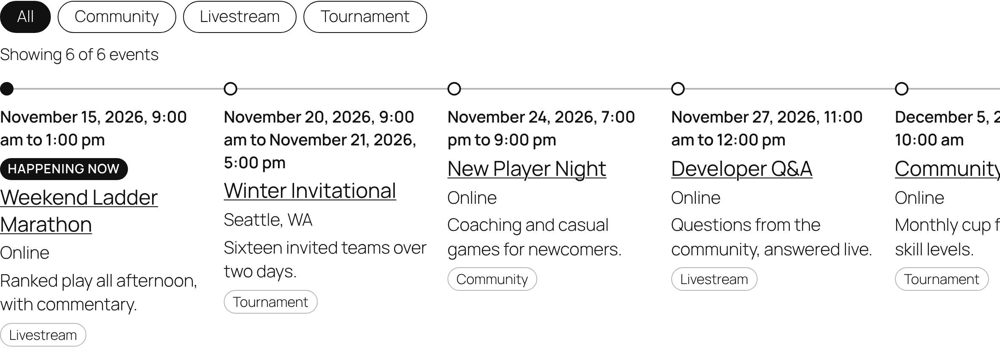
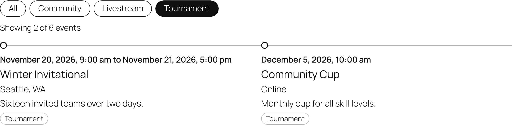
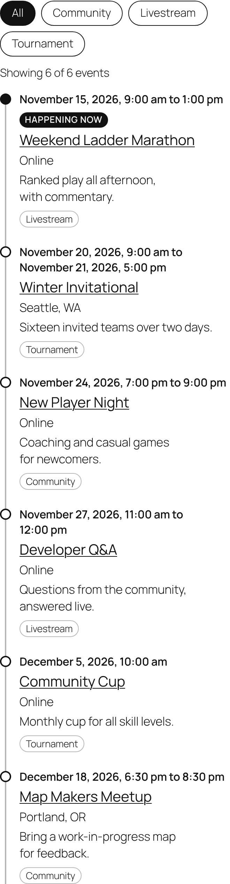

# Events Timeline

A WordPress plugin that adds an **Event** post type and an **Events Timeline** block. Upcoming or past events appear on a horizontal or vertical timeline, with type filters you can link to directly.



Built with the current block toolchain: `block.json` (API v3), a dynamic block rendered in PHP, the **Interactivity API** for filtering, and an editor sidebar panel in React. Tested end to end with Playwright and WordPress core's own e2e utilities.

## Features

- **Event post type** with start, end, location and an optional link, edited in an Event details panel in the block editor sidebar. Saving is locked until an event has a start date, and the panel warns when the end is before the start. The Events list in wp-admin gets a sortable Starts column.
- **Upcoming, past or all events.** Upcoming includes events in progress, marked "Happening now". Past events are listed newest first.
- **Type filters with shareable URLs.** Choosing a filter updates `?event_type=` in the address bar, and back and forward work. The server renders the same filtered state, so a filtered link loads already filtered, with no flash and no JavaScript required.
- **Horizontal or vertical layout.** Horizontal timelines scroll sideways on wide screens and become a vertical list on phones.
- **Fits the theme.** Colors come from the theme's presets, and the block supports alignment, color, spacing and font size.
- **Accessible.** Ordered lists and real headings (level chosen per block), `<time datetime>`, `aria-pressed` on filters, a polite live region announcing "Showing 2 of 6 events", and a keyboard-reachable scroll area. Checked with axe (WCAG 2.2 AA) in the test suite.

| Filtered to tournaments | On a phone |
| --- | --- |
|  |  |

| Event details panel | Block settings with a live preview |
| --- | --- |
|  |  |

## How it works

| Piece | Where |
| --- | --- |
| Event post type, Event type taxonomy, REST-exposed fields with sanitizing | [`includes/post-type.php`](includes/post-type.php) |
| Event queries (upcoming includes in-progress; past handles events with no end), date formatting | [`includes/query.php`](includes/query.php) |
| Block markup and server-side Interactivity state | [`src/timeline/render.php`](src/timeline/render.php) |
| Filtering, URL sync and back/forward | [`src/timeline/view.js`](src/timeline/view.js) |
| Block settings and server-rendered preview | [`src/timeline/edit.js`](src/timeline/edit.js) |
| Event details sidebar panel and save lock | [`src/event-details/index.js`](src/event-details/index.js) |

The derived state (`isActive`, `isHidden`, `statusText`) is defined twice on purpose: as PHP closures passed to `wp_interactivity_state()` and as getters in `view.js`. WordPress evaluates the PHP versions while rendering, so the HTML the server sends already matches what the browser will hydrate.

Dates are stored as site-local `Y-m-d\TH:i` strings, which sort correctly as text, so ordering and comparisons stay in plain meta queries.

## Development

You need Node 20+, and for the local test site, PHP 8.1+ with `pdo_sqlite` and `gd`, git and curl. No Docker or MySQL.

```bash
npm install
npm run build          # or: npm start, to rebuild on change

npm run site:setup     # WordPress 7.1 on SQLite, with this plugin linked and demo events
npm run site:start     # http://localhost:8889  (admin / password)

npx playwright install chromium
npm run test:e2e       # 12 end-to-end tests
npm run lint:js && npm run lint:css
npm run plugin-zip     # installable events-timeline.zip
```

The demo content (`bin/demo-content.php`) uses dates relative to today, so there are always past, upcoming and in-progress events. The Events page it creates has a horizontal timeline with filters and a vertical list of past events.

### Tests

[`tests/e2e`](tests/e2e) covers filtering and URL sync, back and forward, a filtered link with JavaScript turned off, unknown filter values, keyboard use, the in-progress marker, past ordering, both layouts at desktop and phone widths, an axe accessibility scan, the Event details panel (save lock, validation and saved fields through the REST API), and the block's settings and saved markup in the editor.

[CI](.github/workflows/ci.yml) lints, builds, sets up the same local site, runs the e2e suite and uploads the installable zip.

## License

GPL-2.0-or-later, like WordPress.
